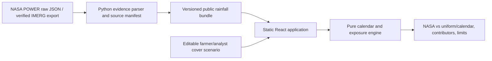

# Arcveld — Malawi Final MVP Product and Engineering Blueprint

**NASA International Space Apps Challenge 2026 · Field Shift: Adapting Farms with NASA Data**  
**Team Arcveld · Final selected direction: Malawi · 14–15 November 2026**  
**Status:** Approved to begin implementation. **Competition-resource eligibility, satellite-data acquisition and farmer-field validation have separate, explicit gates; none is silently represented as completed.**  
**Source basis:** `Arcveld_Malawi_Agricultural_Systems_and_Innovation_Opportunity_Assessment.md` and `Arcveld_Malawi_NASA_Integration_and_Innovation_Validation.md`, inspected on 14 November 2026. The Ohio product is out of scope.

## Executive implementation decision

Build **Arcveld — Soil-Cover Continuity**, a focused, extension-assisted agricultural decision-support prototype for a rainfed **Central Malawi groundnut → maize transition**. The app compares a farmer's current maize → maize pathway with groundnut → maize and evaluates **two potentially feasible residue-return timings** under the groundnut pathway. It replays dated historical NASA precipitation against explicit, editable ground-cover scenarios to show *when and how much regional rain coincided with estimated uncovered ground*. The user sees whether NASA's actual day-by-day distribution changed the historical assessment relative to calendar-only and uniform-rain baselines, and which assumptions constrain the interpretation.

**Product's one-line promise:** *See when a limited stock of protective crop residue may matter most during a maize–groundnut transition, using historical NASA rainfall—not an unvalidated prediction of soil loss.*

**The scientifically demonstrated kernel is a conditional historical exposure comparison, not a field-validated choice of crop or residue date.** This boundary is a requirement, not a disclaimer hidden in About.

### Engineering GO and remaining gates

- **GO NOW for coding:** The agricultural problem, user journey, source-backed NASA POWER reference example, algebra, science boundary, stack, interface, core tests and fallback behaviour are sufficiently specified. The 2022/23 76-day example was independently recalculated from the report's published frozen daily vector (numbers below).
- **GATE BEFORE GLOBAL-AWARDS ELIGIBILITY CLAIM:** Inspect the **official Field Shift Resources** and record an exactly listed NASA dataset and its role in the running scientific calculation. NASA's GO Team explicitly requires one NASA source **from that specific challenge's resource list**. The official tab was unavailable to this research environment. Neither third-party mirrors nor NASA hosting alone establishes eligibility.
- **GATE BEFORE CALLING THE MVP SATELLITE-IMERG-POWERED:** Actually acquire, validate and integrate **GPM IMERG** values. The existing worked result comes from **NASA POWER PRECTOTCORR / MERRA-2**, a coarser reanalysis-derived precipitation source. Do not label those numbers as GPM satellite rainfall.
- **GATE BEFORE REAL-FARM ADVICE:** Verify local cover observations or defensible adviser-supported management constraints and workable return dates. Without them, present **illustrative planning scenarios** and actions to measure/confirm, never a validated optimum, a predicted erosion amount or a claim of improved farm outcomes.

**Do not hold up the application scaffold for the latter two gates.** Build the scientific demo honestly with the reference evidence, while source verification occurs in parallel. The official-resource check is immediate and needs a human browser or organiser if the tab is unavailable.

---

## Part I — Product and agricultural decision

### 1. The local problem and user

The primary user is an agricultural extension officer talking with a rainfed smallholder farmer near **Kasungu, Central Malawi**. Maize supports household production; diversification into groundnut changes the preceding crop and residue source. After crop harvest, residues may be needed for livestock, lost to grazing, removed, protected in storage or returned to fields. Seed and labour may make some operations infeasible. Agronomic studies confirm these practices and constraints occur in Malawi, but **no actual Kasungu participant, parcel or measured ground-cover trajectory has been identified for Arcveld**.

The consequential bounded question is: **Given one limited residue stock and two genuinely workable return dates, which portions of the historical early-rain period would each schedule leave less protected—and does daily NASA rainfall reveal a difference concealed by simpler planning?**

Do not describe this as recommending a date for next year's rain or identifying the objectively best crop rotation. A local adviser may use the result to target field measurements, compare a monitored trial or decide that a proposed operation is unworkable.

### 2. A/B/C journey, without a false rotation claim

| Option | Crop sequence | Role in the application | Evidence boundary |
|---|---|---|---|
| **A · Current practice** | Maize → maize, with the farmer's present residue handling | Show today's sequence, first-season maize presence, and its own cover/input assumptions. Give a historical exposure *scenario* only if an actual or explicit cover profile exists. | Do **not** use A versus B/C rainfall proxy to claim that groundnut–maize has better soil health, yield or long-run benefits. |
| **B · Rotation as ordinarily managed** | Groundnut → maize, with residue constraints and existing practice | Establish the changed crop phase and available material; show a transparent cover scenario and the first-season maize-area trade-off (without speculative yields). | The study supports that groundnut → maize is an existing crop system, not any one assumed cover trajectory. |
| **C · Managed rotation** | Groundnut → maize with protected residue returned | Compare **C-early** and **C-late** dates, holding *the same nominal extra cover profile and residue quantity* across the two timing variants for the controlled science demonstration. | Both dates must be labelled **illustrative** until a local farmer/adviser supports feasibility. |

**The NASA demonstration contrasts C-early vs C-late.** A/B keep the *rotation* integral to the challenge and make the system-level constraints visible. This is **two crop sequences and three management states**, not three unique rotations. Show changes in material source, season, planting and land use without inventing a rotation-attributed numerical effect. A crop-label change alone must not change an environmental calculation.

### 3. P0 inputs and decision status

P0 uses one Kasungu reference case with **one fixed historical window: 1 November–15 January (76 UTC days)** of each selected year-pair. Inputs: selected historical year, estimated baseline fractional cover for A and B (or named observed checkpoints), return schedule for C-early and C-late, amount of **additional effective ground-cover fraction** on return, assumed persistence duration, available residue after household/livestock use, whether the two dates are operationally feasible, and optional soil texture/drainage description for *context only*. A clear **Load research example** action supplies every hypothetical value. All scenario values are visible/editable, with 0–100% labels and units.

P0 treats these as independent constraints: `usableResidue = yes/no/unknown`, `earlyWorkable = yes/no/unknown`, `lateWorkable = yes/no/unknown`, `grazingControl = yes/no/unknown`, `farmerCoverEvidence = observed/adviser_bounded/illustrative`. A stated `no` blocks a corresponding proposed operation; `unknown` leaves it conditional, not feasible by default. Do not infer residue mass from crop type, or mass-to-cover percentage from a guessed coefficient. No passwords, account creation, personal farmer profiles, or stored coordinates.

Outputs: dated historical rainfall, baseline vs NASA comparison, conditional magnitude and direction of **exposure proxy**, sensitivity and counterexample, input and data qualifications, actual practical next step (verify timing/cover or consult extension officer), and source citations. No numeric crop-yield, food-security, nitrogen, soil organic carbon, runoff, erosion or future-risk score.

### 4. P0/P1/P2 scope

| Priority | Feature | Pass condition |
|---|---|---|
| **P0** | Sequence A/B/C with resource/soil context and one editable early-vs-late comparison | Crop paths and first-season maize trade-off are visible. Two dates can be marked unworkable. No fabricated biological effect. |
| **P0** | Source-linked NASA precipitation history and a working historical year selector | At least one complete, traceable, usable 76-day series. Correct product and source version shown; missing data never become zero. |
| **P0** | Deterministic cover scenario + **calendar / uniform / NASA daily** calculations | Results recalculate on edits, with correct formulas and no weather-driven forecast wording. |
| **P0** | Judge-ready **With NASA / Without daily NASA timing** comparison | One screen shows identical calendar/uniform baselines alongside unequal historical result, plus a contradictory season. |
| **P0** | Evidence and constraints panel; methods, disclaimer, sources, print | All inputs tagged observed / historical estimate / hypothetical; printable chart alternative; source/version present. |
| **P0** | Static publicly viewable application plus reproducible local build | No NASA endpoint or login required at browser runtime. Graceful unavailable state and no synthetic provider data silently substituted. |
| **P1** | Five-season comparison and sensitivity bands | Show all five 2018/19–2022/23 results **only once the original daily series for each has been imported, validated and frozen**. Do not reconstruct daily rows from summary totals. |
| **P1** | Four neighbouring rain-location sensitivity, if verified | Show differing **query points**, not fictitious measured plot/cell centres; use same product with attribution. |
| **P2** | Download CSV, gauge comparison, IMERG vs POWER comparison, additional terrain | Only after P0/validation/deployment. No artificial geospatial sophistication. |

---

## Part II — NASA science and sources

### 5. Verified empirical calculation and the exact example

The **14 November Malawi NASA Integration report** records five successful NASA POWER API returns for corrected daily precipitation `PRECTOTCORR`, `AG` community, `MERRA2` source, requested UTC, with 1,902 values per query and no missing fill in the 380 historical analysis days. The report includes an **explicit frozen 76-day daily vector for 2022-11-01 to 2023-01-15** and checksums for the original acquired five response bodies. The exact original API payloads are **not attached** to this blueprint and must be re-fetched/saved for primary provenance before release if possible.

**Recomputed locally from the 76 values included in that report:**

| Fixed 2022/23 example | C-early (15 Nov) | C-late (6 Dec) |
|---|---:|---:|
| Baseline uncovered area-days | **59.225** | **59.225** |
| Uniform-rain exposure, mm-equivalent | **480.31** | **480.31** |
| NASA POWER daily replay, mm-equivalent | **506.83** | **468.47** |
| C-late minus C-early, mm-equivalent | — | **−38.35267857** |

NASA POWER rainfall total for that period: **616.35 mm**. On **27 December 2022**, the report's rain value is **83.34 mm** and illustrative effective cover is 0.150 early versus 0.275 late; contribution to (late − early) is `83.34 * (0.150 − 0.275) = −10.4175` mm-equivalent. This is a dated, auditable explanation of the result; it is **not measured soil loss**.

The source reports central-assumption late-minus-early signs for the remaining years: 2018/19 −16.27, 2019/20 −10.24, 2020/21 −14.10, **2021/22 +3.53 (early lower)**, 2022/23 −38.35 mm-equivalent. Treat those as **research-reported summaries** until the full day-by-day series is obtained and imported. Show the 2021 counterexample; do not imply a consistent preference for late return. The report's five-location, cover-perturbation analysis supports the direction in 2018 and 2022 across its tested variations, not every season, field or product.

**Critical quality distinction:** Real NASA **rainfall inputs** + hypothetical **cover curves** = real-NASA-powered *illustrative exposure scenarios*. This is not plot observation or a measured real-farmer decision.

### 6. Equations and reference scenario (contract)

Use integer day index `d = 0..75`, `d=0` means 1 November of the selected historical starting year. Use UTC day keys and inclusive window endpoints; calendar dates in the user input must be resolved to absolute ISO dates before computation.

For the **source-provided example only**:

- A current maize scenario: fractional cover `0.28` on indices 0–33 and `0.12` thereafter. Its own reference is illustrative, not an observed maize residue curve.
- B groundnut → maize ordinary practice: cover `0.15` across the 76 days. Also illustrative.
- C is B plus identical *finite effective-cover pulse* placed on day `s=14` (15 November) for **early** or `s=35` (6 December) for **late**.
- Example incremental cover peak = `0.25` fraction, remains at peak from pulse age 0–14, then declines linearly to zero by age 28. It is an **analyst's illustrative time response**. Not a measured groundnut decay law.

```text
age = d - startIndex
if age < 0: extraCover = 0
else:
    extraCover = peak * max(0, min(1, (duration - age) / (duration - plateau)))
# for the fixed example peak=.25, duration=28, plateau=14
coverC[d] = clamp(coverB[d] + extraCover, 0, 1)
```

Before allowing user edits, require `0 ≤ baseCover ≤ 1`, `0 ≤ peak ≤ 1`, `0 ≤ plateau < duration`, `0 ≤ effective cover ≤ 1`, `0 ≤ startIndex < 76`, and both pulses entirely within the analysis window for the **equal-calendar** illustration. If either pulse clips outside the window, explicitly mark baseline comparability affected and compute correctly instead of retaining the “tie” claim. For a common stock, assume **equal effective cover amount** across early and late only for the controlled example. In practice timing may change survival and availability; revalidate before farmer-facing advice.

For source daily rain `P[d] ≥ 0 mm` and cover `c[d]`:

```text
D = Σ_d (1 - c[d])                                   # uncovered area-days (fraction-days)
calendarLowCoverDays(t) = count(c[d] < t)             # informational; t=.20 in example
Pbar = (Σ_d P[d]) / n                                 # mean daily rainfall
E_uniform = Pbar * D                                  # mm-equivalent
E_daily   = Σ_d P[d] * (1 - c[d])                     # mm-equivalent
Δ_late_early = E_daily(late) - E_daily(early)
eventContribution[d] = P[d]*(coverEarly[d] - coverLate[d])
```

The **rainfall timing effect** is demonstrated when early and late have equal `D` and equal total rain, so the uniform baseline ties while `Δ_late_early != 0`. The sign and magnitude are **retrospective scenario exposure differences**, not actual soil damage, expected savings, risk probabilities or next-season best dates. Select the source's observed day series first; user edits must never alter the reference rainfall itself.

For incomplete series, show coverage and disable full-period comparisons; never treat missing as zero. Zero rainfall is valid. Nonfinite, negative, duplicate/conflicting dates and unmatched product units are errors. Do not compare a 76-day season against a different-length season without explicitly changing the question and its baseline. Distinguish wet-day calendar convention (UTC versus Malawi UTC+2) prominently.

### 7. NASA product hierarchy and eligibility decision

1. **At once: official challenge Resources.** Human opens: `https://www.spaceappschallenge.org/2026/challenges/field-shift-adapting-farms-with-nasa-data/?tab=resources`. Capture the exact listed NASA data source **title, official URL, screenshot or organiser confirmation, and whether used in the code/calculation**. The GO Team's public answer explicitly requires a listed NASA source for Global Awards. If the site fails, ask the Johannesburg organiser to show or confirm the resource. **Do not infer that POWER and GPM must be eligible because third-party lists mention them.**
2. **Preferred primary Earth observation:** GPM IMERG Final Daily V07 (`GPM_3IMERGDF_07`, DOI `10.5067/GPM/IMERGDF/DAY/07`, ~0.1° daily). NASA GPM's official directory confirms the product, Earthdata login requirement and GES DISC acquisition route. Actual Malawi payload was **not acquired** in the research phase: authenticated requests 401, one DAP 400, Giovanni unsuccessful. Preferred single point near **−13.05, 33.45**, Nov–Jan windows 2018/19–2022/23; verify returned grid coordinates and units, quality flags and date coverage. Retain all raw export hashes. Auth through local Earthdata credentials; do not commit credentials or embed them in browser code.
3. **Alternative IMERG route:** Google Earth Engine public dataset `NASA/GPM_L3/IMERG_V07` has half-hour scenes. Requires an eligible authenticated Earth Engine project. Verify that scene metadata identifies the relevant **Final/permanent** run before calling it equivalent to IMERG Final Daily; integrate half-hour **mm/hr × 0.5 h** after QA, UTC grouping and sample-coverage checks. Do not replace Final series with provisional observations silently.
4. **Already executed technical fallback:** NASA POWER Daily Point API `PRECTOTCORR`, corrected MERRA-2 reanalysis precipitation, `AG` community, UTC. Re-fetch the report's exact Kasungu query and store raw JSON under gitignored data/raw. **Use this as the main demo data only if an official listed source requirement is satisfied by POWER (or a different qualifying NASA source is genuinely used in the analytical workflow).** If POWER does not qualify, POWER remains research baseline/supplementary source and cannot alone establish Global Awards eligibility. Do not call MERRA-2 values “satellite GPM measurements.”
5. **Other NASA layers (SRTM, SMAP, HLS) are out of P0.** They cannot fix an unmeasured cover curve, and decorative maps do not improve scientific validity. Add only if they support a new independently valid calculation and time remains.

**Explicit handoff item:** `sourceEligibility: {state: confirmed|unconfirmed, listedTitle, officialUrl, capturedAt, confirmedBy, productUsedInCalculation}` must be stored independently of `scientificMode: {power_reanalysis_scenario|imerg_satellite_scenario|unavailable}` and `coverBasis: {illustrative|adviser_bounded|field_observed}`. A confirmed source does not validate cover or the proxy; strong science does not prove official listing.

### 8. Data acquisition and source requirements

Canonical POWER query already used in research:

`https://power.larc.nasa.gov/api/temporal/daily/point?parameters=PRECTOTCORR&community=AG&longitude=33.45&latitude=-13.05&start=20181101&end=20240115&format=JSON&time-standard=UTC`

Read source/version, units, time basis, fill value and `YYYYMMDD → PRECTOTCORR` from the returned JSON. Make sure daily rate is interpreted as equivalent accumulated **mm per day**, in the provider's reporting convention, before producing `rainMm`. For historical windows include exactly 2018-11-01→2019-01-15, 2019-11-01→2020-01-15, 2020-11-01→2021-01-15, 2021-11-01→2022-01-15 and 2022-11-01→2023-01-15. Preserve historical year and query point separate from an actual field identifier.

The research's frozen 2022 vector is also supplied separately in `Arcveld_Malawi_2022_Research_Rainfall_Reference.csv`. It is transcribed from the report, not the provider's original raw JSON. Use it for initial calculations and tests, then verify against the NASA API snapshot. The source report records SHA-256 of five API responses; original bytes must be reacquired to check those hashes, and provider reprocessing could change the response.

If `IMERG` is retrieved, produce a separate dataset with its own units, footprint, time and quality. Do not overwrite the NASA POWER pack or claim equivalence. Compute and display both results **side by side** if time permits; changed rain source means changed scientific result and numerical claims, so rerun all tests and rehearse the pitch after the switch.

**Minimum independent corroboration** before claiming validated real-rain events is a checked provider export (separate read-back/date) and, if accessible, an aligned independent daily local rain gauge. Adjacent POWER queries share model lineage and are *sensitivity*, not independent validation.

### 9. Cover evidence and how to close its remaining gap

The research located Malawi field-practice evidence for retaining, stacking, protecting and returning residues, but **did not locate a dated percent-ground-cover trajectory for a specific Kasungu maize/groundnut parcel**. Do not make this a blocking condition for building a **historical scenario explorer**. Make it a blocking condition for any **real-world advice**, claim that the dates are feasible on a named farm, or claim that Arcveld predicts rotation-specific protection.

To upgrade if an adviser/participant is available: obtain permission; record one actual parcel or anonymised strip with previous crop, planned crop, material type and approximate available amount *after household/feed needs*, access/grazing, two genuinely workable return dates and cover by a repeated FAO-style transect/photo method. Cover checkpoints: before return, just after, 2 and 4 weeks, after a significant disturbance. Report uncertainty and whether two schedules could retain equal material. Keep local documentation private unless publishable; release only approved aggregated inputs. **A verbal confirmation alone can support feasibility assumptions, not manufacture measured cover fractions.**

If none of this is available, all UI states say **illustrative management comparison using research-sourced NASA rain**. The “next step” is measuring cover and checking resources with an extension officer, not “return residue on 6 December.”

### 10. Scientific disclosure/claim register

| Can claim | Cannot claim |
|---|---|
| NASA POWER rain values produced an audited historical difference **for the declared hypothetical cover schedules**; the daily distribution explains a tie under a uniform baseline. | NASA rain directly measured an individual Kasungu farm or its crop residues. |
| Malawi research documents groundnut/maize systems and locally reported residue use, storage and constraints. | Our illustrative cover curves are typical of Kasungu, measured, or experimentally calibrated. |
| Four of five research years favour late in the central assumption; 2021/22 is a counterexample and assumptions/spatial choices change some comparisons. | The later return is the statistically best choice or will outperform early return in the coming season. |
| Rain-weighted uncovered fraction is a **mm-equivalent exposure proxy**, useful for historical scenario screening. | Calculated mm-equivalent are tonnes of soil erosion, runoff, infiltration, soil health, crop yield or reduced risk. |
| The proposed workflow has a documented distinction from publicly described AgroTutor and PICSA features. | Arcveld is globally first, scientifically superior or field-validated against those platforms. |

---

## Part III — Application and engineering

### 11. Approved stack and architecture

**Vite + React + TypeScript**, Tailwind CSS v4, a *small* local selection of shadcn/ui primitives, Zod at data-boundaries, Recharts for rain and exposure plots, Lucide icons, Vitest for pure services, Python 3.11+ standard library for source ingestion, Playwright for the critical browser path, and **GitHub Pages** for static hosting. Node LTS compatible with current Vite. Prefer native form controls. No database, account, chatbot, backend, live provider API or runtime credentials. One page, one app state, bundled and validated public evidence JSON.

Architecture:



Do not include real identifiers or permissions-protected records in `dist`. No `VITE_` environment variables containing credentials. Bundle one reviewed dataset; no API dependency on pitch day.

### 12. Visual/product experience

Use a distinctive, polished *light agricultural-science* identity: warm neutral background `#F8F6EF`, white/off-white cards, forest green `#1E503C`, deep charcoal `#202B28`, rainfall blue `#265A70`, restrained soil-ochre `#72531B`, understated borders; accessible contrasting text and focus. Public Sans (appropriately licensed and locally bundled if available), clear typography, responsive width, sparse iconography. Use NASA sources prominently but **do not use NASA insignia as an endorsement**.

**Top-to-bottom one-page story:**

1. **Header:** Arcveld wordmark, “Kasungu, Malawi · historical NASA-powered soil-cover scenario,” source/product/eligibility badges, and obvious **Load research example**.
2. **Agricultural system:** horizontal A maize → maize, B groundnut → maize, and C managed groundnut → maize strips. Show what is *not* computed (first-season maize amount, yield, erosion). The link between crop phase and available residue is explanatory, not automatically numeric.
3. **Management studio:** editable early and late operation dates, cover/persistence controls, feasibility states and transparent scenario labels. Keep B and C separate; never silently infer that a user has enough residue or labour.
4. **NASA scientific reveal — hero panel:** side-by-side **Without daily NASA timing** and **With historical NASA data** values. Show both calendar area-days and uniform-rain mm-equivalent versus actual daily-rain estimates, a named reference year, and the signed difference. Include an explanation such as: “Same nominal coverage; different dates; 2022/23 daily rainfall makes the historical proxy 38.35 mm-equivalent lower in the later-return illustration.” No green verdict labelled “best.”
5. **Interactive evidence:** 76 daily rain bars, early/late cover lanes, labelled UTC dates and top contributing event rows. Chart has a table equivalent. Hover is optional; selected day must be keyboard accessible.
6. **Counterexample and limitations:** 2021/22 +3.53 under research assumptions (only as verified summary until raw daily pack added), source quality, soil context, notes, assumptions, unresolved real-farm feasibility. “What would confirm this for your field?”
7. **Sources / methods / print:** official NASA product title, version, query coordinates, time standard, source URLs, research references, open inputs and limitations. Print view retains full numerical/provenance text.

At 360 px, stack panels and preserve all numerical results with no horizontal page overflow. Semantic HTML and labelled inputs. Test keyboard, 200% zoom, high contrast, visible focus, reduced motion and day-table equivalence. Colour/animation must not encode evidence status alone.

### 13. Directory and contracts

```text
arcveld/
  README.md
  METHODS.md
  DATA_SOURCES.md
  THIRD_PARTY_NOTICES.md
  package.json
  vite.config.ts
  src/
    App.tsx
    styles.css
    components/
      CropSequence.tsx
      ScenarioControls.tsx
      NASAComparison.tsx
      RainEvidence.tsx
      SourcePanel.tsx
    domain/
      dates.ts
      cover.ts
      exposure.ts
      evidence.ts
      *.test.ts
    data/
      rainfall.json
  scripts/
    prepare_rainfall.py
    tests/test_prepare_rainfall.py
  data/
    sources.json
    README.md
    raw/                   # gitignored
  tests/
    e2e/primary-journey.spec.ts
    fixtures/             # synthetic input-only tests, never app release
  .github/workflows/pages.yml
```

**Evidence bundle minimum fields** (Zod schema, Python mirror):

```text
schemaVersion: 1
caseId: "kasungu-reference"
sourceMode: "POWER_MERRA2_PRECTOTCORR" | "GPM_IMERG_FINAL_DAILY_V07"
scientificMode: "historical_illustrative" | "adviser_bounded" | "field_observed"
eligibility: {state, listedTitle?, officialUrl?, confirmedAtUtc?, evidenceRef?}
reference: {name, queryLatitude, queryLongitude, coordinateBasis:"query_point"|"verified_grid_cell", gridResolutionDescription, knownLimitations[]}
product: {provider, collection, variable, version, units, timeStandard:"UTC", accessUrl, retrievedAtUtc, rawSha256?, sourceReferences[]}
seasons: [{id, startIso, endIso, days:[{dateIso, rainMm:number|null, quality, sourceId}]}]
scenarioDefaults: {basis:"illustrative", A, B, early, late, peakExtraCover, plateauDays, durationDays}
validation: {providerPayloadVerified:boolean, oneDayCrossCheck:boolean, localGaugeCompared:boolean, completeness:string}
```

Do not encode `eligibility:confirmed` by default. `sourceMode` and displayed citation must match the actual shipped numerical series; no unlabelled mixing of rain products. The browser engine is pure: rain reference immutable, cover edits only change derived cover and exposure. Inputs are user-side ephemeral state. Release may include illustrative cover *if visibly labelled*, but **no fabricated NASA rainfall, silent fills or restricted field data**.

**Required pure functions:** `validateRainfallBundle(unknown)`, `makeCoverCurve(config, n)`, `evaluateFeasibility(constraints)`, `calculateExposure(rainDays, coverCurve)`, `compareAgainstBaselines(rainDays, earlyCurve, lateCurve)`, `eventAttribution(...)`, `formatScientificClaim(...)`. Separate calculations and text labels, no unconstrained generative AI.

### 14. Acceptance tests and independent calculations

**Must-pass unit tests**:

- Exactly 76 dates for Nov 1→Jan 15, including leap-year transition correctly; wrong years, reversed interval or UTC/date duplicates rejected.
- Research vector for 2022/23: 76 valid days, total **616.35**, both `D=59.225`, uniform **480.3069572368421**, daily early **506.8266071428571**, daily late **468.4739285714286**, delta **−38.35267857142858** (tolerance 1e-6). Display rounding only.
- `2022-12-27` day contribution **−10.4175**; top-event table values match chart and total contribution sum.
- `E_daily = E_uniform` for uniform rainfall and the same total. If early and late cover curves are identical, delta exactly zero. If one curve dominates day-by-day, no input rainfall can make the more-covered curve have higher exposure.
- Cover 0 and 1 produce expected endpoint results; clipping, invalid cover, negative rain, null/missing days and source/provenance mismatches fail or withhold.
- The claim “calendar/uniform ties” disappears after any user edit causing different `D` or equal assumptions to break; never hardcode the opening comparison results.
- A maize→maize vs B groundnut→maize **crop-name edit alone does not change the environmental result**. No fabricated rotation effect.
- Changing scenario dates **does not change historical NASA rain**, and A/B and C-early are not mutated by editing C-late.
- `unknown` operation feasibility produces a **conditional** result; unavailable/residue denied produces a **blocked** plan while data remain inspectable.
- Scientific-mode/cover-basis/official-eligibility statuses remain independent. An otherwise correct example with `eligibility=unconfirmed` must not show “Global Awards eligible.”
- A report-only 2021/22 value cannot be rendered as a daily chart without an actual matching imported 2021/22 day pack.

**Manual checks:** reproduce one date directly from the actual NASA provider; save raw request/response, units and version; inspect one weather-source mismatch or gauge comparison if accessible; verify source links and copied code licences. Mobile/browser test must work with all NASA and third-party origins blocked. Test print and anonymous public URL.

### 15. Contingencies and release modes

| Situation | Required action |
|---|---|
| Official Resources accessible and **IMERG listed** | Acquire qualified IMERG Final daily, validate original payload, compare result with POWER, and use IMERG in central engine. Note that a different precipitation source may change sign/magnitude. |
| Official Resources accessible and **POWER listed, IMERG not listed** | Use independently re-fetched NASA POWER source if permitted by challenge listing; describe it as NASA POWER / MERRA-2 historical corrected precipitation, not direct GPM. Keep a genuine EO addition optional only if it improves science. |
| Official Resources inaccessible or listed eligibility unresolved | **Continue building** with visible `unconfirmed` status; seek organiser confirmation immediately. Do not assert Global Awards eligibility. |
| Earthdata login/export fails | Do not delay a working POWER scientific demonstration; continue with separately labelled NASA source and eligibility flag. No fictitious IMERG series. |
| Farmer cover and operation evidence unavailable | Ship the historical **illustrative scenario explorer**, not an actionable farm prescription. Describe the local measurement needed to upgrade. This is a real limitation to competitive validity. |
| NASA rainfall input unavailable during collector run | Last reviewed, attributable historical snapshot is acceptable if hash/date/source preserved; do not silently substitute test fixtures or claim real observations. If there is no real usable pack, show a research-demo unavailable state and do not claim analytical completeness. |
| NASA difference changes sign or disappears with edits | Show the new result and qualifications. A null/contradictory finding is scientifically legitimate. |
| Two-day time pressure | Cut extra NASA datasets, map, animations, multi-year interactive filtering, sensitivity sliders, CSV download, then any redundant component; **retain NASA-versus-baseline, A/B/C sequence, sourcing, tests and public pitch.** |

---

## Part IV — Authorised build execution

### 16. Immediate parallel actions (not new research stages)

**Human at browser / venue:** Verify the official challenge Resources listing, exact local pitch/judging instructions, source/AI disclosure and submission fields. Create or approve **one** new GitHub repository (proposed name `Arcveld`, subject to availability; visibility chosen by team). NASA Space Apps Project tab deadline is **Sunday 15 November 2026 at 23:59 local time**; the Johannesburg live pitch or venue may have an earlier operating deadline. Record which deadline controls the demo. If official website inaccessible, ask local lead; **do not wait for this answer to scaffold**.

**Data owner:** Obtain revalidated POWER raw JSON and preserve source metadata; verify 2022/23 sample and import all five years. In parallel attempt Earthdata/GES DISC IMERG or an active Earth Engine project, **but stop pursuing access when it endangers the required public demo**. Keep an early-correctness snapshot; if IMERG replaces it, retest numerical outputs and pitch captions.

**Codex:** Scaffold and implement pure calculator from this blueprint with synthetic fixtures and research-backed validated sample separately. Do not create mock satellite observations as production data. Include exact testing before elaborate styling.

### 17. Commands and standards

From a clean approved repository during the authorised event: `npm create vite@latest . -- --template react-ts`; install Tailwind v4 via its current Vite instructions; choose only necessary shadcn/ui primitives and check licences; add Zod, Recharts, Lucide and development tools Vitest/Playwright. Use current compatible Node LTS, npm lockfile and Python 3.11+ for standard-library ingestion. Script names: `dev`, `lint`, `typecheck`, `test`, `test:e2e`, `build`, `preview`. Repeated checks: `npm run lint`, `npm run typecheck`, `npm test`, `python3 -m unittest discover -s scripts/tests`, `npm run build`, `npm run test:e2e`. For GitHub Pages, set Vite `base` for the repository path, use approved GitHub Pages Actions with minimum permissions, verify compiled assets and direct link anonymously. Keep `data/raw/`, `.env*` and credentials ignored; licence and citations visible.

### 18. Five sequential Codex implementation prompts

**PROMPT 1 — Foundation and source state**

> Read the full Malawi blueprint and inspect the existing repo before modifying anything. Scaffold Vite React/TS, Tailwind 4, chosen shadcn primitives, source/provenance panel, responsive accessible one-page Arcveld shell, explicit `NASA source: unconfirmed` and `cover inputs: illustrative` states. Set up scripts, tests, lint/typecheck/build and source licence notices. No fake satellite data, crop-yield or soil claims, API credentials, server or extraneous pages. Run lint/typecheck/build. Report changed files, checks, open source decisions and proposed feature-sized commit. Do not push without approval.

**PROMPT 2 — Scientific kernel**

> Inspect code and blueprint §§5–6 and §14. Implement pure date handling, cover curves, feasibility statuses, uncovered area-days, uniform-rain baseline, daily NASA rain exposure and per-day attribution. Import the provided 2022 research reference CSV **as source-derived test/example input, not synthetic NASA data** and tag the raw-provider revalidation gate. Implement exact expected values 616.35, 59.225, 480.3069572368421, 506.8266071428571, 468.4739285714286 and −38.35267857142858. Verify the 27 Dec event. Test malformed cover/rain, incomplete periods, equality, dominance, date edits and immutability. Return documented numerical values and test logs. Suggested commit: `feat(science): implement NASA rainfall-cover exposure comparison`.

**PROMPT 3 — Audited NASA evidence pipeline**

> Inspect science kernel and blueprint §§7–9. Build Python stdlib NASA POWER JSON ingestion with source/version/unit/UTC checks, 76-date completeness, source hashes, independent run provenance and normalized `rainfall.json`. Keep raw NASA responses gitignored and provider credentials private. Add optional import contract for separately verified GPM IMERG Final daily without making external runtime calls. Preserve eligibility, source mode and cover-basis independently in typed schemas. Never claim IMERG acquisition if only POWER was used. Reject forged/mismatched data. Run Python and TS schema tests. Report exactly which live NASA request was independently performed versus copied from research vector and what remains unresolved. Suggested commit: `feat(data): validate and bundle traceable NASA rainfall`.

**PROMPT 4 — Decision experience, judge reveal and responsive UI**

> Inspect existing code and blueprint §§1–4 and §§11–13. Build A maize→maize, B groundnut→maize, and C two management timings with explicit resource constraints and hypothetical cover inputs. Centre one excellent `Without daily NASA timing / With NASA` result card, historic rain chart and accessible day table; show year, product, dates, mm-equivalent, event attribution, counterexample and scientific limitations. The precise result must recompute after editing; do not recommend a date from retrospective observations or infer rotation impacts from crop labels. Present any unavailable values and an explicit practical next measurement. Use premium light editorial design, strong mobile layout and 200% zoom. Run tests/build/e2e. Suggested commit: `feat(ui): explain NASA-driven Malawi exposure scenarios`.

**PROMPT 5 — Validation, release and pitch freeze**

> Inspect all data/source files and blueprint §§14–20. Run full scientific and browser acceptance tests, verify 2022 example against actual source or clearly record unverified provider bytes, check live official listed resource before setting eligibility confirmed, inspect bundled files for private data and fabricated NASA rows, produce README/METHODS/DATA_SOURCES and credits/AI disclosure, configure GitHub Pages and smoke-test anonymous public delivery. Create a concise 30-second demo path around equal calendar coverage and a historically different NASA result, including the counterexample and limitations in the extended explanation. Never auto-submit or assert local-farm benefits. Report failures, exact claim level, source URLs, deployment URL if actually available, and proposed commit. Suggested commit: `chore(release): verify Malawi MVP and prepare submission`.

### 19. Hackathon delivery sequence and stopping rules

- **Saturday now:** source listing + repo + science kernel + raw POWER verification; do not delay UI on Earthdata auth. First working page proves a 2022/23 NASA-versus-uniform result with proper labels.
- **Saturday main effort:** working full user journey and first local build, then the public static deployment. If source status is open, visibly disclose it and ask the local lead. One technical owner handles provider data; one handles UI if teammates are available.
- **Sunday early:** rerun full checks, swap to *verified* qualifying NASA IMERG only if source/data/units are ready and recalculation is tested; do not break the stable demo for speculative multi-source sophistication.
- **Before the local pitch:** freeze numerical examples, labels and presentation. Show actual named source. Ensure `No data`, `Illustrative`, and `Unconfirmed NASA eligibility` cannot be hidden by styling. Show one unfavourable season when asked about robustness.
- **Before official submission:** project page, source repo, public app/demo, source/third-party/AI notices, rights, accurate NASA resource reference, local deadline and confirmation. Official global platform closes **Sunday 15 November 23:59 Johannesburg time**; venue may need earlier.

### 20. Live pitch and minimum completion

**30-second arc:** “In Central Malawi, crop residues compete with livestock and soil protection. Arcveld compares a maize–groundnut transition and two possible return dates. In our 2022/23 *illustrative* cover example, the dates tie under calendar and uniform-rain baselines. Actual **NASA POWER/MERRA-2** daily rainfall shifts the historical exposure estimate by **38.35 mm-equivalent**: this storm on 27 December helps explain why. This isn't predicted erosion or tomorrow's rain; it shows which field cover and timing measurements could make the choice evidence-based.” If and only if IMERG is in the shipped data, replace POWER name and figures with **IMERG-recomputed** values.

**90-second backup:** state study basis and farmer constraints; show crop-sequence meaning; demonstrate one day multiplication; show 2021/22 contradictory example; explain NASA data product/resolution/UTC; distinguish illustrative cover from observed rainfall and source listed eligibility; give next verification step.

**Minimum MVP accepted as a *scientifically honest demo*** when the user can compare crop sequences and edit two residue dates, at least one real attributable NASA rainfall series changes a traceable calculation, the calendar/uniform baseline is implemented, exposure and event attribution pass tests, all unobserved cover is explicitly marked illustrative, provenance/eligibility are honest, and a local build plus public link/demo are validated. **Do not call it farmer-validated, erosion-predicting or Global-Awards-eligible merely because these engineering tests pass.**

---

## Original source and programme references

- NASA Space Apps 2026 Field Shift challenge: https://www.spaceappschallenge.org/2026/challenges/field-shift-adapting-farms-with-nasa-data/
- Official challenge Resources (requires human/organiser confirmation): https://www.spaceappschallenge.org/2026/challenges/field-shift-adapting-farms-with-nasa-data/?tab=resources
- NASA GO Team resource/credit requirement: https://github.com/nasa/spaceapps/discussions/1827
- NASA 2026 submission timetable: https://www.spaceappschallenge.org/2026/
- Johannesburg local event: https://www.spaceappschallenge.org/2026/local-events/johannesburg/
- NASA POWER Daily API: https://power.larc.nasa.gov/docs/services/api/temporal/daily/
- NASA POWER data sources: https://power.larc.nasa.gov/docs/methodology/data/sources_meteorology/
- NASA GPM IMERG official products and acquisition: https://gpm.nasa.gov/data/directory
- GPM IMERG Final Daily V07 DOI: https://doi.org/10.5067/GPM/IMERGDF/DAY/07
- Google Earth Engine IMERG catalogue: https://developers.google.com/earth-engine/datasets/catalog/NASA_GPM_L3_IMERG_V07
- FAO soil-cover measurement exercise: https://www.fao.org/fileadmin/user_upload/GSP/GSDP/Field_exercises/NEW_Field_exercises/P07-soil-cover-EN.pdf
- Malawi seven-season residue practice publication: https://doi.org/10.1371/journal.pone.0298009
- Malawi crop-system study: https://doi.org/10.1016/j.fcr.2024.109565
- Malawi soil hydraulic study: https://doi.org/10.1016/j.still.2020.104639
- AgroTutor Malawi study: https://doi.org/10.1016/j.compag.2026.111557
- PICSA and e-PICSA: https://research.reading.ac.uk/picsa/e-picsa/
- Vite: https://vite.dev/guide/ ; Tailwind: https://tailwindcss.com/docs/installation/using-vite ; Playwright: https://playwright.dev/docs/intro

**Authoritative project evidence for the worked example:** `Arcveld_Malawi_NASA_Integration_and_Innovation_Validation.md`, §§5–8 and Appendix, and `Arcveld_Malawi_Agricultural_Systems_and_Innovation_Opportunity_Assessment.md`, Parts I–V. Where this blueprint makes a design choice, it is identified as an engineering/product decision, not a measured agricultural fact.
